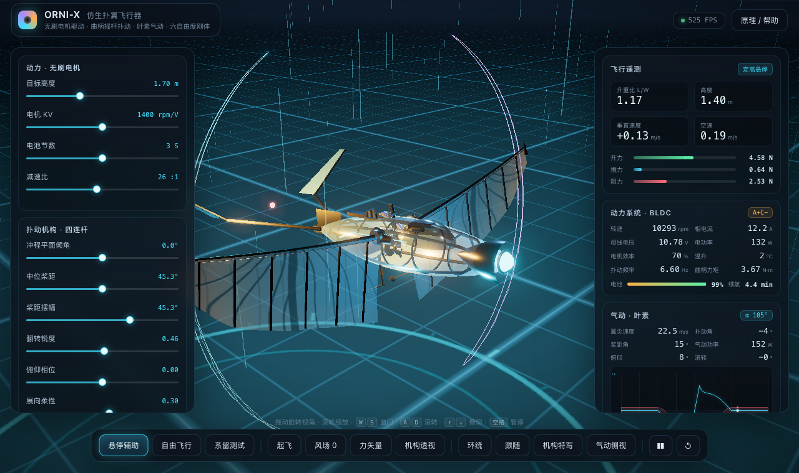
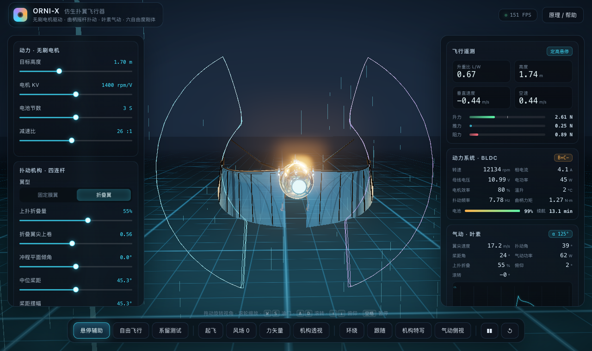
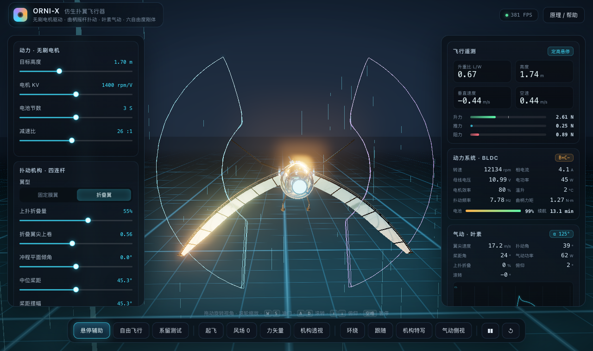
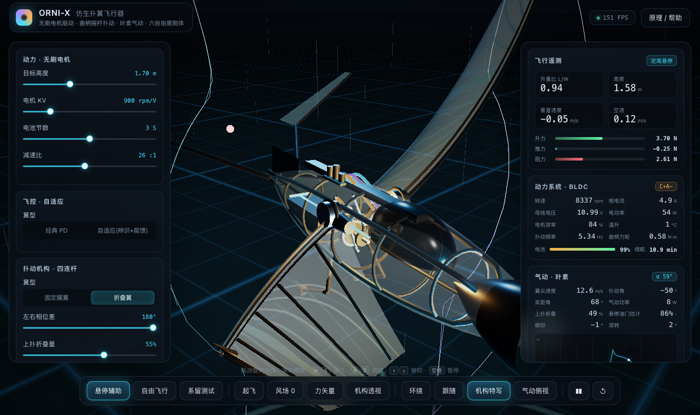

# ORNI-X · 仿生扑翼飞行器实时仿真

**ORNI-X** 是一个运行在浏览器里的仿生扑翼无人机（ornithopter）实时仿真器。它把
三相无刷电机、26:1 减速传动、曲柄摇杆四连杆、准定常叶素气动和六自由度刚体动力学
串成一个闭环：油门改变转速，转速改变扑动与桨距，气动力反过来决定机体姿态、电流、
温升与续航。画面中的扑动、翼膜鼓起、翼尖轨迹和 HUD 读数全部由物理计算驱动，
没有预录动画。

技术栈：**Three.js（渲染）+ cannon-es（刚体）+ 原生 ES Modules（无构建步骤）**。

---

## ▶ 在线预览

**<https://stellanproject.github.io/bionic-ornithopter/>** —— 纯静态，打开即用，无需安装。

- 🎬 [演示视频（12 s，对置扑动 + 力矢量 + 机构特写）](media/demo.mp4)
- 📐 [理论手册](docs/THEORY.md) · 🗺 [路线图/实验记录](docs/PLAN-stable-lift-flybrain.md)



| 上扑收拢（折叠翼 55%） | 下扑全展 |
|---|---|
|  |  |



---

## 功能特性

- **BLDC 电-机-热模型**：KV、相电阻、ESC 限流、电池内阻压降、六步换向扇区、SOC、
  一阶热网络；负载力矩由气动广义力实时折算。
- **曲柄摇杆四连杆**：闭式位置解、装配分支自动选择、Grashof 校核、传动角与速度比
  分析；输出端驱动翼根扑动。
- **两种翼型（可切换）**：
  - **固定膜翼**：整周翼展不变的基础翼型。
  - **上扑折叠翼**（默认）：上扑阶段按归一化扑动角速度收拢翼面——翼展沿展向收缩
    （翼尖最多收缩 55%，可调 0–90%）、翼尖额外上卷，等效减小上扑迎风面积。
    实测上扑段阻力功率由约 5 W 降至 1 W 量级，同时上扑负升力被抹平；
    折叠是气弹式运动学调度 `fold = k·smoothstep(−φ̇/0.45)`，物理与视觉共用同一条
    展向半径函数 `spanAt(s, fold)`，所以 HUD 里的"上扑折叠"读数就是真正生效的收缩比例。
- **被动桨距调度**：由归一化扑动角速度驱动翼面翻转，下扑"兜风"、上扑"切气"，
  可调相位、幅度、削顶锐度。
- **准定常叶素气动**：9 段展向离散、线性升力段 + Viterna 失速后极曲线、法向/切向
  力分解、面积加权迎角；左右翼独立积分。
- **六自由度飞行**：cannon-es 刚体、地面接触、平尾/垂尾、机体阻力、悬停辅助
  （定高 + 姿态 PD）、自由飞行与系留测试三种模式。
- **风与阵风**：基础风速/风向 + 多频正弦阵风；风同时影响升力、推力、阻力和电流。
- **工程可视化**：翼尖 8 字轨迹、风流线、LIFT/THRUST/DRAG/W/NET 力矢量、机构透视、
  实时极曲线、三相电流与 PWM 示波器。
- **无构建、纯静态**：浏览器通过 import map 直接加载 `vendor/` 下的 Three.js 与
  cannon-es，改源码刷新即可生效。

---

## 快速开始

### 环境要求

- 支持 WebGL2 的现代浏览器（Chrome / Edge / Firefox / Safari 新版）。
- Python 3（或任意静态文件服务器）。
- Node.js ≥ 18 **仅用于运行测试**（浏览器端不需要 Node）。

### 启动

在项目根目录执行：

```bash
cd bionic-ornithopter
python3 -m http.server 8137
```

然后打开 <http://127.0.0.1:8137>。

也可以用任意静态服务器，或直接用项目脚本（等价于上面的 Python 命令）：

```bash
npm run serve      # 端口被占用时会失败，可改用 python3 -m http.server <端口>
npm test           # 物理自检（Node，不需要浏览器）
```

> **不要**直接双击 `index.html` 用 `file://` 打开：ES module 和 import map 会被
> 浏览器的同源策略拦截，页面无法加载模块。

### 可选：安装开发依赖

浏览器运行只依赖仓库内的 `vendor/`，无需 `node_modules`。如果要跑无头浏览器测试，
再执行：

```bash
npm install
```

---

## 操作指南

### 鼠标 / 相机

- **拖动**：环绕旋转视角（OrbitControls）。
- **滚轮**：缩放，距离限制约 0.28–9 m。
- 底部视图按钮：**环绕**（固定机位）、**跟随**（跟随机体）、**机构特写**（对准
  曲柄摇杆与电机）、**气动侧视**（从侧后方观察翼面与来流）。
- 相机俯仰被限制在地平面以上（最大极角约 89°），不会钻到地面以下。

### 键盘

| 按键 | 作用 |
| --- | --- |
| `W` / `S` | 悬停模式：目标高度 +/−；自由/系留模式：油门 +/− |
| `A` / `D` | 滚转（左右差动扑动/辅助滚转） |
| `↑` / `↓` | 俯仰（升降舵/辅助俯仰） |
| `Q` / `E` | 偏航（方向舵） |
| `空格` | 暂停 / 继续 |
| `R` | 重置（参数恢复默认、机体回到 1.7 m） |
| `H` | 打开 / 关闭帮助弹窗 |
| `V` | 显示 / 隐藏力矢量 |
| `C` | 机构透视（机体蒙皮变透明） |
| `1` / `2` / `3` | 切换 悬停辅助 / 自由飞行 / 系留测试 |

### 三种飞行模式

| 模式 | 行为 | 适用场景 |
| --- | --- | --- |
| **悬停辅助** | 高度 PI 回路自动给油门；俯仰/滚转由 PD + 积分力矩稳定；目标高度滑杆与 W/S 生效 | 观察配平、升重比与功耗 |
| **自由飞行** | 切断增稳，油门、升降舵、方向舵、差动扑动全部手动；纯物理，容易翻滚 | 体验真实飞行动力学 |
| **系留测试** | 机体位置/姿态锁在台架高度；只保留气动与电机 | 直接读升力、推力、电流 |

### 底部工具条

| 按钮 | 作用 |
| --- | --- |
| **起飞** | 切到悬停辅助，重置到 0.35 m，并以 2.0 m 为目标高度自动爬升 |
| **风场** | 在 0 → 3 → 6 → 9 m/s 之间循环 |
| **力矢量** | 显示 LIFT / THRUST / DRAG / W / NET 箭头 |
| **机构透视** | 半透明蒙皮，露出电机、同步带、四连杆与扭力管 |
| **暂停 / 重置** | 暂停仿真；重置参数与初始状态 |

### 左侧参数面板

滑杆会实时写入 `src/config.js` 的参数对象；修改会立即影响物理，不需要重启。

**动力 · 无刷电机**

| 滑杆 | 范围 | 说明 |
| --- | --- | --- |
| 油门 / 占空比 | 0–100 %（自由/系留模式显示） | ESC 占空比指令 |
| 目标高度 | 0.5–4.0 m（悬停模式显示） | 定高回路的目标 |
| 电机 KV | 600–2200 rpm/V | 改变反电动势/转矩常数 |
| 电池节数 | 2–4 S | 改变母线电压与空载转速 |
| 减速比 | 14–40 : 1 | 改变曲柄转速与反射惯量 |

**扑动机构 · 四连杆**

| 滑杆 | 范围 | 说明 |
| --- | --- | --- |
| 冲程平面倾角 | −0.35–0.35 rad | >0 产生前向推力 |
| 中位桨距 | 0.25–1.33 rad | 翼面平均安装角 |
| 桨距摆幅 | 0.1–1.1 rad | 翻转幅度 |
| 翻转锐度 | 0–0.9 | 越大越接近方波 |
| 俯仰相位 | −1.4–1.4 rad | 0 为角速度驱动，±π/2 为位置驱动 |
| 展向柔性 | 0–0.55 | 翼尖/翼根扑动幅度差 |

**环境 · 风**

| 滑杆 | 范围 | 说明 |
| --- | --- | --- |
| 风速 | 0–12 m/s | 基础风 |
| 风向 | 0–360° | 水平面方向 |
| 阵风强度 | 0–0.7 | 相对基础风速的阵风比例 |
| 空气密度 | 0.8–1.3 kg/m³ | 影响动压 |

**仿真 · 时间**：时间倍率 0–2×（0 即冻结，与暂停类似但保留输入）。

底部的**恢复默认参数**会重新加载页面并恢复 `config.js` 初始值。

### 右侧遥测面板

| 区域 | 内容 |
| --- | --- |
| 飞行遥测 | L/W 升重比、高度、垂直速度、空速、升力/推力/阻力条 |
| 动力系统 · BLDC | 转速、相电流、母线电压、电功率、电机效率、温升、扑动频率、曲柄力矩、SOC、续航 |
| 气动 · 叶素 | 翼尖速度、扑动角、桨距角、气动功率、俯仰/滚转、实时 CL/CD 极曲线 |
| 三相换向示波器 | A/B/C 相电流（按当前扇区重构）与 ESC 占空比 |

各字段的严格定义（平滑方式、符号、单位、计算口径）见
[理论手册的遥测参数表](docs/THEORY.md)。

### 画面元素

- **翼尖轨迹**：右翼青色、左翼紫色，最近 90 个采样点拼成 8 字轨迹。
- **力矢量**：LIFT（绿）、THRUST（青）、DRAG（红）、W（灰）、NET（琥珀）。
- **风流线**：320 条实例化短线段，随风速方向运动，强度随风速与升力变化。
- **翼膜鼓起**：翼段法向载荷驱动翼膜顶点位移（8 段载荷分布）。
- **机构动画**：电机转子、同步带齿、曲柄、连杆、摇臂、扭力管都按仿真真实角度驱动。

---

## 文件结构

```text
bionic-ornithopter/
├── index.html              页面骨架、HUD、按钮、帮助弹窗
├── styles.css              深色玻璃拟态 UI
├── package.json            依赖声明（three / cannon-es / playwright-core）
├── vendor/                 浏览器直接加载的第三方库
│   ├── three.module.js
│   ├── cannon-es.js
│   ├── OrbitControls.js
│   └── addons/             后处理等 Three.js 附加模块
├── src/
│   ├── main.js             启动、主循环、相机、装配各模块
│   ├── config.js           全部物理/机构/电气/气动参数
│   ├── linalg.js           极简 3×3 矩阵与矢量工具
│   ├── kinematics.js       四连杆闭式解、桨距调度、翼面站位
│   ├── aero.js             极曲线（含 Viterna）、叶素力、翼面积分
│   ├── drivetrain.js       BLDC + ESC + 减速箱 + 电池 + 热模型
│   ├── sim.js              六自由度刚体、三种模式、遥测
│   ├── scene.js            渲染器、天空、地面、光照、泛光后处理
│   ├── airframe.js         碳纤维骨架、蒙皮、尾翼、起落架、机载电子
│   ├── wingMesh.js         翼膜网格与法向载荷变形
│   ├── mechanism.js        电机、同步带、曲柄摇杆、扭力管可视化
│   ├── vfx.js              风线、翼尖轨迹、力矢量
│   └── ui.js               控制面板、HUD、示波器、极曲线、帮助
├── docs/
│   ├── THEORY.md           理论手册：方程、推导、参数表、模型边界
│   └── help-html.md        可直接注入帮助弹窗的 HTML 片段
├── tests/
│   ├── tune.mjs            参数标定：油门/桨距/倾角对升力与功率的影响
│   ├── physics.test.mjs    纯 Node 物理自检（连续性、NaN、L/W、效率）
│   ├── browser.mjs         playwright 无头浏览器冒烟测试
│   └── shots/              浏览器测试截图
├── tools/
│   └── pwtest.mjs          最小 WebGL/Chrome 环境探测
└── node_modules/           仅测试用（浏览器运行不依赖）
```

---

## 技术栈

| 层 | 选型 | 说明 |
| --- | --- | --- |
| 渲染 | Three.js 0.167.1（vendor） | WebGL2、PBR、PMREM 环境光、阴影、UnrealBloom 后处理 |
| 刚体 | cannon-es 0.20.0（vendor） | 重力、地面接触、SAP 宽相、12 次求解迭代 |
| 模块 | 原生 ES Modules + import map | 无打包器、无转译，改代码刷新即生效 |
| UI | 原生 DOM + Canvas 2D | 滑杆、HUD、示波器、极曲线 |
| 测试 | Node.js + playwright-core | 物理断言 + 本机 Chrome 无头冒烟 |

---

## 物理模型速览

完整的方程、推导、数值与参数表见 **[docs/THEORY.md](docs/THEORY.md)**。核心链路：

1. **六自由度刚体**（cannon-es）：质量 0.40 kg、惯量
   `[0.022, 0.032, 0.024]` kg·m²，气动力/力矩在机体系汇总后转到世界系。
2. **BLDC 电-机-热**：`KV=900 rpm/V`、相电阻 `0.090 Ω`、3S 900 mAh 电池、
   26:1 减速、0.86 效率；准静态电流解 + 六步换向 + 电池内阻压降 + 一阶热网络。
3. **四连杆**：曲柄 24 mm、连杆 55 mm、摇杆 32 mm、机架 52 mm，满足 Grashof；
   摇杆半摆幅约 52.6°、传动角 27°–90°；翼根扑动通过 `flapGain` 传递。
4. **气动**：9 段叶素，线性段 + Viterna 失速后极曲线，法向/切向分解
   `F = qS(Fn·n + Fd·d)`；冲程平面倾角 + 被动桨距产生推力。
5. **风/阵风**：基础风 + 多频正弦阵风，经相对风影响迎角、升力、阻力与电机负载。

---

## 调参与测试

### 参数标定

```bash
node tests/tune.mjs
```

输出不同油门、中位桨距、桨距幅度、俯仰相位、冲程倾角下的扑动频率、电流、功率、
升力、推力与 L/W，用于理解参数趋势。

### 物理自检

```bash
node tests/physics.test.mjs
```

纯 Node 运行，检查四连杆整周连续、摇杆摆幅、全油门扫掠无 NaN/Infinity、稳态电流
为正、扑动频率随油门单调、悬停窗口 L/W、电功率 ≥ 机械功率等。失败时退出码为 1。

### 浏览器冒烟测试

先启动静态服务器（终端 A）：

```bash
python3 -m http.server 8137
```

再运行（终端 B）：

```bash
node tests/browser.mjs
# 或指定地址 / 有头模式
node tests/browser.mjs --url http://127.0.0.1:8137
node tests/browser.mjs --headed
```

测试使用本机 Chrome（macOS 路径
`/Applications/Google Chrome.app/Contents/MacOS/Google Chrome`）和 SwiftShader
软件渲染，收集 console error / pageerror、检查 canvas 非全黑、HUD 非 NaN，并模拟
按钮、滑杆与按键操作，同时把截图写入 `tests/shots/`。

---

## 调试

页面暴露了调试句柄 `window.__ORNI`：

| 字段 | 内容 |
| --- | --- |
| `sim` | 仿真对象（`body`、`tele`、`dt`、`kin`、`crank` 等） |
| `view` | 渲染器、场景、相机、控制器、composer |
| `ui` | 控制面板状态、滑杆定义、帮助开关 |
| `craft` | 机体 Three.js Group |
| `mech` | 机构可视化对象 |
| `wings` | 左右翼网格 |

例如在控制台查看电机与配平状态：

```js
__ORNI.sim.tele
__ORNI.sim.dt.current
__ORNI.sim.body.position
```

---

## 已知限制

- 气动为准定常叶素模型，不包含前缘涡、动态失速延迟、附加质量、尾涡下洗与地面效应。
- 翼面弯曲/扭转是运动学预设，不是结构动力学求解。
- 电机模型不含相电感、PWM 纹波、磁饱和、铁损与六步换向的瞬时转矩脉动。
- 电功率按 `V_bus * I` 统计（未乘占空比），部分油门时效率偏保守；热损耗用
  `0.75 I²R` 近似。详见理论手册第 8.5 节。
- 电池模型只有内阻 + 线性 OCV，不含温度特性与老化。
- 极曲线与 Reynolds 数无关，Viterna 系数来自风力机经验外推。

这些简化适合"趋势正确的实时工程仿真"和交互演示；若用于真实飞行器设计验证，
需要 CFD、动态失速模型、结构气动弹性与更完整的电机/电池模型。

---

## 文档

- **[docs/THEORY.md](docs/THEORY.md)**：理论手册（六自由度、BLDC、四连杆、叶素、
  能量流、遥测定义、完整参数表、数值实现）。
- **[docs/help-html.md](docs/help-html.md)**：帮助弹窗用的 HTML 片段，可直接注入
  `#help-body`。

---

## 致谢

- [Three.js](https://threejs.org/)（MIT）— 渲染、后处理、控制器。
- [cannon-es](https://github.com/pmndrs/cannon-es)（MIT）— 刚体物理。
- 气动建模参考经典叶素理论、Grashof 四连杆判据与 Viterna 失速后极曲线方法。


